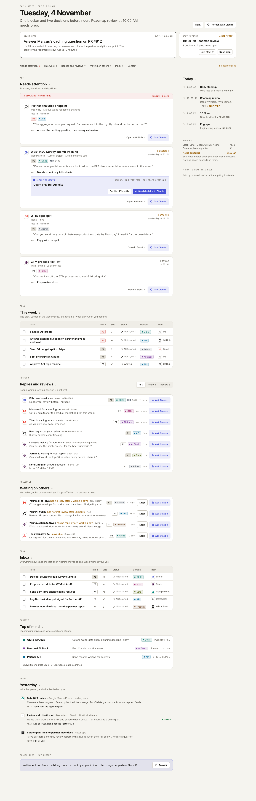
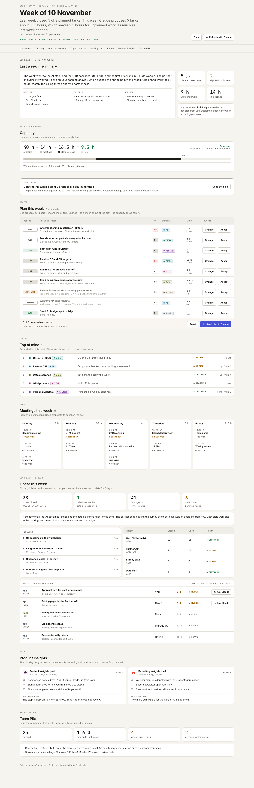
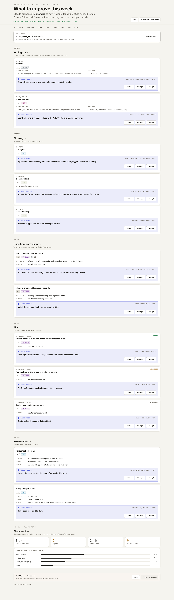

# Personal AI Operating System

A plugin for Claude Code and Cowork that turns Claude into a personal operating system for your work. It keeps a private second brain and a task board in a local folder, builds a daily and a weekly briefing page from your calendar, mail, chat and tickets, and learns from your corrections. Everything stays on your computer; nothing is pushed anywhere.

## What it looks like

Daily page (fictional Acme data):



Weekly page:



Friday review page:



## What is in it

**Components**

- **Storage (second brain):** a Karpathy-style wiki in plain markdown. One folder per kind of knowledge, a `CLAUDE.md` rule file per folder, a one-line summary per page, and generated indexes so Claude reads the map before the pages.
- **Tasks (board):** one `board.md` with Top of mind, This week, Inbox and Agent. Every task has an id, priority, size, domain, status, a "closed when" line, a source and a deep link.
- **Visualise:** read-only daily and weekly pages (single HTML files, work offline) built from the board and your inputs.
- **Dashboard:** the weekly page, with board proposals, project status, team code status and plan vs actual.

**Loops**

- **Daily:** `brief` collects what is new, re-plans the board, preps meetings and lists what needs you and what you wait on. `sync`, `radar`, `next` and `capture` run on demand.
- **Weekly:** `weekly` on Monday re-sorts the board and preps the week. `review` on Friday compares drafts with what you sent and learns your style and vocabulary.
- **Monthly:** `refresh` updates context, lints the wiki and proposes a reorganisation.
- **Improvement:** every routine logs friction and drafts. `review` and `improve` turn them into rule changes you approve.

**Skills** (called `/personal-ai-os:<skill>`): `setup`, `brief`, `weekly`, `review`, `refresh`, `sync`, `next`, `capture`, `radar`, `meeting-prep`, `ingest`, `improve`, `demo`.

**Role adapters:** product manager, engineering lead, sales and customer success, founder or executive. They change tool defaults, routine emphasis, glossary seeds and typical meeting types, nothing else.

## Install

### Claude Code

In a session:

```text
/plugin marketplace add cdudek/personal-ai-operating-system
/plugin install personal-ai-os@personal-ai-os
```

Or from the shell:

```bash
claude plugin marketplace add cdudek/personal-ai-operating-system && claude plugin install personal-ai-os@personal-ai-os
```

### Cowork

1. Customize > Plugins > Add marketplace, enter `cdudek/personal-ai-operating-system`, then Install.
2. Or build the zip and use Add > Upload plugin: run `scripts/build-zip.sh` and upload `dist/personal-ai-os-<version>.zip`.

Unverified: this repo is marketplace and plugin in one (source `./`). Whether Cowork accepts a root-level source is not confirmed; if the marketplace route fails, use the zip. A plugin installed in Cowork syncs to Claude Code at the next session start; a CLI install stays local.

## Set up

Run `/personal-ai-os:setup`. It interviews you (name, company, team, role, day to day, goals, tools, writing samples, languages), tells you which connector to switch on per tool, picks a role adapter, copies the workspace template to a folder you choose (default `~/ai-workspace`, never a synced folder), fills in your rules and context, starts a local git repo, creates the scheduled tasks and offers a first brief. Want a preview first? Run `/personal-ai-os:demo`; it needs no connectors.

The setup skill copies `${CLAUDE_PLUGIN_ROOT}/template/workspace`. In Claude Code that variable works in skills; in Cowork it is unverified, so the skill falls back to finding the template next to itself or asking for the plugin path.

## Scheduling

Setup creates four tasks inside your workspace project, each with the prompt "Follow routines/<name>.md":

- brief: weekdays 7:27
- weekly: Monday 6:57
- review: Friday 15:57
- refresh: first Monday of the month 7:57

If it cannot create them, it prints them for you to add under Scheduled > New task in Cowork or in Claude Desktop. Local tasks only run while your computer is awake and the app is open.

## Privacy

- The workspace is a local folder and a local git repo. Never add a remote. Do not put it in iCloud, Dropbox or another synced folder.
- Connectors read your data (mail, calendar, chat, tickets). Claude reads it during a run; this plugin sends nothing anywhere itself.
- Nothing is saved to your context pages without your yes, and nothing is sent or posted for you without your yes.
- The optional phone capture by DM to yourself in a work chat is company data. Never write anything private there; use the private drop folder or a voice notes app for that.
- Respect your company's policy on AI and connectors before you switch them on.

## Update, uninstall

```text
/plugin marketplace update personal-ai-os
```

Your workspace is a copy, so updates do not touch it. To get new routine versions, compare `routines/` with the plugin's `template/workspace/routines/`.

Uninstall with `/plugin uninstall personal-ai-os@personal-ai-os` and `/plugin marketplace remove personal-ai-os`. Delete the workspace folder and `~/.config/personal-ai-os/` by hand if you want everything gone.

## Troubleshooting

- **Skills do not show up:** restart the session after install, then type `/personal-ai-os:` to list them.
- **Template not found in setup:** the skill asks for the plugin folder; give it the path where the plugin is installed or unzipped.
- **A connector is missing:** the routine skips it and says so; enable it and re-run, or let Claude use the browser.
- **Views are empty or missing:** the daily and weekly pages need the files in `views/` from the template; check that `views/template.html` exists.
- **A scheduled task did not run:** the computer was asleep or the app closed. Run the skill by hand.

## Credits

Inspired by Daniel Bloom's "How I AI" episode on his Cowork system and by Andrej Karpathy's idea of an LLM-maintained wiki.

MIT licence, 2026 Calvin Dudek.
