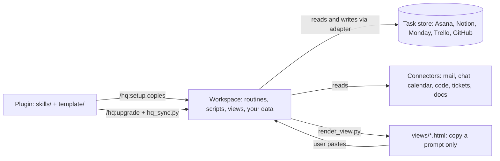

# Architecture (for maintainers)

Who calls what. Paths are relative to the plugin (`skills/`, `template/`) or, for `routines/`, `meta/`, `context/`, `views/`, `scripts/`, to `template/workspace/` (the copy in the user's workspace). Keep this page in step when you add, rename or remove a file.

## Layers

- **System files** (the plugin may overwrite them, after a diff when you edited them): `routines/**`, `scripts/**`, `views/` code, `SYSTEM.md`, each top-level `*/CLAUDE.md`, `research/_template/**`. List and logic: `system_files()` in `scripts/hq_sync.py`.
- **User data** (never touched): everything else, including the root `CLAUDE.md`, `context/`, `meta/`, `research/<topics>/`, `views/data/` and the rendered pages.
- The root `CLAUDE.md` of the workspace holds the rules every routine obeys (rule numbers are referenced from routines and views).

## Skill -> routine

Every skill starts with `skills/_shared/version-check.md` (workspace lookup, version check, voice, three-line ending).

- `brief` -> `routines/brief.md` (daily), `weekly.md` (weekly), `sync.md` (update)
- `task` -> `next.md` (no argument), `capture.md` (free text), the adapter for `list/add/move/set/done`
- `inbox` -> `radar.md`
- `meeting` -> `meeting-prep.md`
- `improve` -> `review.md` (review), `improve.md` (tip)
- `wiki` -> `ingest.md`, `refresh.md`
- `debrief` -> `debrief.md`
- `setup` -> copies `template/workspace/`, uses `template/adapters/<role>.md`, `routines/people.md` (Map colleagues), `routines/stores/<store>.md` + `README.md` (+ `asana-fields.md`), `research/_template/`, then `scripts/build_index.py`, `scripts/hq_sync.py manifest`
- `upgrade` -> `scripts/hq_sync.py plan|apply`, the migrations in its own file, `scripts/build_index.py`, `scripts/render_view.py`
- `demo` -> `scripts/render_view.py` on `template/sample/*.json` in a temp copy

## Routine -> routine

- `brief` -> `meeting-prep`, `radar`; matches people through `people.md`; scores ICE (its own "ICE scoring", referenced by `weekly`, `task`, `improve`)
- `weekly` -> `radar`, `meeting-prep`; ICE and gap rules from `brief`; `people.md` for matching
- `sync` -> `radar` (collect = `brief.md` step 1)
- `next` -> `radar`
- `meeting-prep` -> `people.md` (Refresh "Current" before a 1:1)
- `review` -> `improve.md` (tips, Area drift, ICE drift, People data, Context cards)
- `refresh` -> `people.md` (monthly), research lint
- `capture` -> files into inbox, ideas, lists, journal, sources, `research/<topic>/working/`
- `ingest` -> `sources/`, `research/<topic>/working/`, context pages (after a yes)

## Routine -> what it reads

- Always: workspace `CLAUDE.md` (rules, tool routing, Required sources, Inbox mode), `index.md`.
- `meta/task-store.md` -> names the store; `routines/stores/<store>.md` does every read and write; `routines/stores/README.md` is the shared model (properties, Source values, context card); `asana-fields.md` only for Asana fields.
- `context/areas/index.md`: brief, weekly, task (add), improve (drift). `context/people/*`: every routine that names a person (ids). `context/me.md`, `goals.md`, `glossary.md`: brief, weekly, review. `context/writing-style.md`: next, radar (drafts), review. `context/places.md`: setup, research rules.
- `meta/`: `friction.md` (every routine appends, review reads), `drafts.md` (next, radar write; review reads), `tips.md` (brief, capture write; improve, review read), `learnings.md` (review, improve write), `plan-vs-actual.md` (debrief writes; weekly, review read), `chat-cursor.md` (brief, sync).
- `research/<topic>/README.md` and `output/`: brief (new folders), weekly 4b (documents per initiative), refresh 2b (lint), ingest, capture.

## Scripts

- `render_view.py <data.json>`: `views/template.html` + `app.css` + `app.js` + `vendor/alpine` + fonts + `icons/` + data -> `views/<kind>-<date>.html` and `<kind>.html` (not for date `sample`). Prints `LABEL CHECK` and `LINK CHECK`. The task tool's logo comes from `meta/task-store.md` (`store:`).
- `build_index.py`: frontmatter `summary:` -> `index.md` per folder and root. Skips `research/`, `scripts/`, `views/vendor|icons|data`. Leaves a hand-written `index.md` (`context/areas/`) alone.
- `hq_sync.py manifest|plan|apply|selftest`: hashes of system files in `.hq-manifest.json` decide `new | safe | edited | same | obsolete`. Refuses in a workspace with `.hq-author`.
- Plugin repo: `scripts/release.sh` (bump, stub, commit, tag), `check-version.sh` (four version places agree), `build-zip.sh` (Cowork upload), `scrub-check.sh` (no private terms; `.scrub-terms` is git-ignored).

## View fields -> producer

Schema: `views/CLAUDE.md`. Page buttons only copy a prompt: `Refresh` -> `sync` / `weekly` / `review`; `Ask`, `Prep`, `Decide` -> `next`; `Drop` -> `radar`; staged edits -> `<<<CHANGES>>>`, `<<<PLAN>>>`, `<<<REVIEW>>>` blocks (rule 4 in the workspace `CLAUDE.md`).

- **daily** (`brief.md` step 5)
  - `meetings[]`: `meeting-prep.md` step 5 (`attachments`, `action_items`, `between`, `topic`)
  - `sections` needs / replies / waiting: `radar.md`
  - `board.week|inbox`, `top_of_mind[]`: the task store adapter (`id`, `url`, `section`, `priority`, `ice`, `moscow`, `size`, `initiative`, `what/state/decision`)
  - `docs[]`: the initiative's topic README in `research/`
  - `sources[]`: Required sources check
  - `start_here`, `yesterday`, `questions[]`: brief steps 4 and 5
- **weekly** (`weekly.md` step 6)
  - `last_week`, `capacity`: `meta/plan-vs-actual.md`, calendar
  - `proposals[]`: task store plus weekly step 3
  - `days[]`: `meeting-prep`
  - `linear`, `teamprs`, `insights`: tickets, code, recurring inputs
  - `top_of_mind[].updates`: weekly 4b
- **review** (`review.md` step 7)
  - `style`: `meta/drafts.md`
  - `glossary`: week's vocabulary
  - `fixes`: `meta/friction.md` plus the drift checks in `improve.md`
  - `tips`: `meta/tips.md`
  - `routines_new`, `plan_actual`: review steps 3 and 6

## Versions

`.claude-plugin/plugin.json`, `.claude-plugin/marketplace.json`, `template/workspace/.hq-version` and the top `CHANGELOG.md` heading carry one version (`scripts/check-version.sh`). `/hq:upgrade` compares the workspace `.hq-version` with the plugin and runs the migrations in `skills/upgrade/SKILL.md` for each step with a data change; a version without a migration only needs the file sync.
